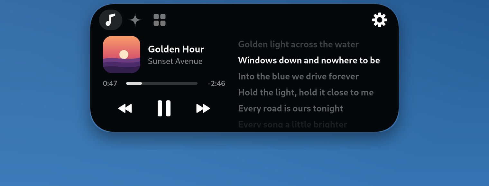
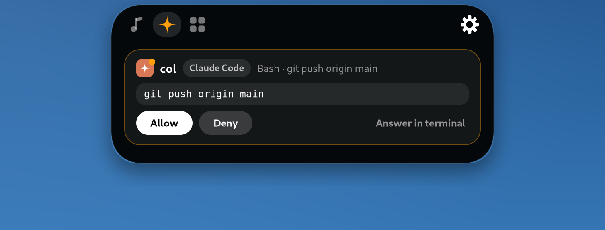
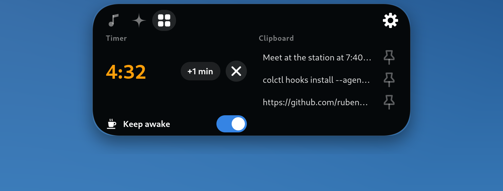

# Col for Linux (preview)

**The island at the top of your screen.**

Col for Linux puts a small black island at the top of the screen, a few pixels below the edge, rounded on every side.
While you work it shows what matters: the song playing, a coding agent waiting for you, the volume, a timer, your own
scripts. Rest the pointer on it, or click it, and it opens.

This is the first Linux edition of [Col](../README.md), shipped with Col 3.0.0 as a preview. It is written in Vala
with GTK 4 and libadwaita: a native app, no web view. MIT licensed, like the Mac app.

<p align="center">
  
</p>

## What it does

- **The island.** Hidden at rest by default: the top edge of the screen, in the middle, brings it out. Or keep a small
  capsule there all the time (Settings, General). Rest the pointer on it and it opens; a click opens it at once; it
  closes shortly after the pointer leaves. Clicks anywhere else go to the windows below. Right-click opens the settings.
- **Now playing.** Any player that speaks MPRIS: Spotify, browsers, VLC, mpv with its plugin, Rhythmbox and most
  others. The cover, the title, a scrubber you can drag, play, pause, next and previous. In the closed island, the cover,
  the title and a small equalizer. Col follows the player you started last, and keeps counting the time itself for the
  players that always say they are at 0.
- **Synced lyrics.** The words of the song beside the player, the line being sung lit; click a line to jump there.
  Optionally the line being sung in the closed island. From [LRCLIB](https://lrclib.net), an open database, or from
  your own `Artist - Title.lrc` files in `~/.local/share/col/lyrics`.
- **Coding agents.** Claude Code and Codex in the island while they work, with their project and what they do. When one
  asks for permission, the island opens with the whole command and Allow, Deny, or Answer in terminal. A command too
  long to check on the card can only be answered in the terminal. Other agents and scripts report with `colctl agent`.
- **Volume and battery.** A gauge when the volume of the output changes (PipeWire or PulseAudio), the charger plugged
  in, a low battery.
- **Tools.** A timer that counts down in the closed island, keep awake, and a clipboard history kept in memory (only
  the copies you pin are saved; copies that password managers mark as secret are skipped).
- **Your own activities.** `colctl push`, the local API and `col://` links put your builds, deploys and scripts in the
  island, the same way as on the Mac.
- **English and French**, following the language of your desktop.

| Closed | Open |
|---|---|
|  |  |
|  |  |

## Desktops

| Desktop | The island | Notes |
|---|---|---|
| KDE Plasma 6, COSMIC, Hyprland, Sway, niri, Wayfire | A layer-shell overlay, centred at the top, above everything | The full experience. On Plasma, turn off the visual feedback of the Audio Volume widget to see only Col's gauge. |
| GNOME | An XWayland window placed under the top bar | GNOME has no layer-shell. Col runs under XWayland as a dock window: it stays above other windows but below the top bar, and below full-screen apps. With fractional scaling it may look soft. The clipboard history uses X11. |
| X11 sessions | The same window as on GNOME | Not tested yet. |

On a MacBook with a notch running Asahi Linux, the screen starts below the notch by default, and the island floats
there as on any screen. With the notch area turned on, the island would sit behind the camera: Wayland does not say
where a notch is, so Col cannot step around it yet.

Col needs GTK 4.14 or later and libadwaita 1.5 or later: Ubuntu 24.04, Debian 13, Fedora 40, Arch and later.

## Install

### Debian and Ubuntu

Download `col_3.0.0_amd64.deb` (or `arm64`) from the [release](https://github.com/ruben4reall/col/releases), then:

```sh
sudo apt install ./col_3.0.0_amd64.deb
```

For Ubuntu 24.04 and later and Debian 13. Open Col from your applications. It installs `col-island` (the app) and
`colctl` (the command). The app is not called `col`: that name belongs to a text filter most distributions already have.

### Any distribution

```sh
tar xzf Col-3.0.0-linux-x86_64.tar.gz
Col-3.0.0/install.sh            # for you, in ~/.local
sudo Col-3.0.0/install.sh --system   # or for everyone, in /usr/local
```

`install.sh --uninstall` takes it away. The libraries come from your system; the script names the ones missing.

### Links that always lead to the latest release

Each release also carries its packages under names without a version, so these links never change:

| Package | Link |
|---|---|
| Debian and Ubuntu, x86-64 | https://github.com/ruben4reall/col/releases/latest/download/col_amd64.deb |
| Debian and Ubuntu, ARM64 | https://github.com/ruben4reall/col/releases/latest/download/col_arm64.deb |
| Tarball, x86-64 | https://github.com/ruben4reall/col/releases/latest/download/Col-linux-x86_64.tar.gz |
| Tarball, ARM64 | https://github.com/ruben4reall/col/releases/latest/download/Col-linux-aarch64.tar.gz |

```sh
curl -LO https://github.com/ruben4reall/col/releases/latest/download/col_amd64.deb
sudo apt install ./col_amd64.deb
```

### Arch Linux

`packaging/linux/arch/PKGBUILD` builds the release with the system's `gtk4-layer-shell` (`makepkg -si`).

### Build from source

```sh
# Debian, Ubuntu
sudo apt install valac meson ninja-build pkg-config libgtk-4-dev libadwaita-1-dev libjson-glib-dev \
  libsoup-3.0-dev libpulse-dev libwayland-dev libwayland-bin wayland-protocols libx11-dev gettext
# Fedora
sudo dnf install vala meson gtk4-devel libadwaita-devel json-glib-devel libsoup3-devel \
  pulseaudio-libs-devel wayland-devel wayland-protocols-devel libX11-devel gettext gtk4-layer-shell-devel

meson setup build linux
meson compile -C build
meson test -C build --suite col
build/src/app/col-island
```

When the system has no `gtk4-layer-shell` (Ubuntu 24.04), meson downloads its release and builds it into the
program. `meson setup build linux -Dapp=false` builds only `colctl`.

## Using it

- Rest the pointer on the top edge, in the middle: the island comes out, then opens.
- `col-island --settings`, `colctl settings`, the island's gear, or a right-click on the island: the settings.
- Open Col again from your applications while it runs: its settings.
- `col-island --quit` quits it.

Col starts at login when you turn it on in Settings, General (a file in `~/.config/autostart`).

## colctl and the local API

The same commands and the same requests as on the Mac ([docs/api.md](../docs/api.md)):

```sh
colctl push build --title Build --symbol hammer --tint orange --progress 40%
colctl done build
colctl remove build
colctl list
colctl status
colctl agent Aider working --message "Refactoring the parser"
```

Col listens on `$XDG_RUNTIME_DIR/col/col.sock` (`COL_SOCKET` moves it): HTTP/1.1 with JSON, mode 0600 in a 0700
folder, and each connection is checked to come from your user. `GET /v1/status`, `GET /v1/activities`,
`POST /v1/activities`, `POST /v1/activities/<id>/done`, `DELETE /v1/activities/<id>` and
`POST /v1/agents/events?agent=claude|codex|gemini|cursor|copilot`.

```sh
curl --unix-socket "$XDG_RUNTIME_DIR/col/col.sock" -X POST http://col/v1/activities \
  -d '{"id":"deploy","title":"Deploy","progress":0.6,"tint":"teal"}'
```

`--symbol` takes the SF Symbol names scripts written for the Mac use (`hammer.fill`, `checkmark`, `bell`,
`cup.and.saucer.fill`, `timer`, `arrow.down`...): Col draws its own glyph for each, and a hexagon for the others.
`col://push?id=tea&title=Tea&ttl=240`, `col://done?id=tea`, `col://remove?id=tea` and `col://settings` work too
(`xdg-open "col://..."`).

## Coding agents

In Settings, Agents, click Connect, or from a terminal:

```sh
colctl hooks install --agent all     # Claude Code and Codex, when they are on this computer
colctl hooks status
colctl hooks uninstall --agent claude
```

| Agent | Where Col adds its hooks |
|---|---|
| Claude Code | `~/.claude/settings.json` |
| Codex | `~/.codex/hooks.json` (run `/hooks` once in Codex and trust Col's) |

Col adds its entries and keeps everything else in the file as it was, in its order; it keeps a copy beside it,
`settings.json.col-backup`, readable by you only. A settings file that is a link (dotfiles) stays a link. The hooks
call `"$HOME/.local/bin/colctl" hook`, the same line as on the Mac, so a settings file shared between a Mac and a Linux
machine works on both; Col links `~/.local/bin/colctl` to its own command.

`colctl hook` never holds an agent up: when Col is not running, it gives up within 300 ms and lets the agent carry on.
A permission request waits up to 90 seconds for your answer in the island, then goes back to the terminal.

## Privacy

- No account, no telemetry, no analytics, no crash reports.
- Col reaches the network for these, and nothing else:
  - [LRCLIB](https://lrclib.net), while lyrics are on (Settings, Music): the title, the artist, the album and the
    length of the song playing. The answer is kept in `~/.cache/col/lyrics`, so a song is asked once.
  - The cover of the song playing, when the player gives an `http(s)` address for it rather than a file (Spotify, some
    browsers): Col downloads that image from that address, as the player itself does, and keeps it in
    `~/.cache/col/art`.
- The clipboard history lives in memory. Pinned copies are saved in `~/.config/col/settings.json` (mode 0600).
- Scripts and agents reach Col through a socket only your account can open, never over the network.

## Light on your computer

Measured with `linux/tools/measure.sh` on Ubuntu 24.04 (arm64) under a headless Sway, one minute at rest after start:

| Memory (RSS) | Of which its own (PSS) | Processor | Wake-ups |
|---|---|---|---|
| 39 MB | 29 MB | 0.000 % | 3 per minute |

Nothing ticks at rest: frames are drawn only while the island moves, and the clocks of the open pages run only while
the island is open. Col draws with GTK's Cairo renderer, which is plenty for an island and keeps it from loading a
graphics driver; `GSK_RENDERER=ngl col-island` brings the GPU back.

## Known limits of the preview

- No pages to compose, no shelf, no agenda, no AI page, no prompter, no extensions, no headphones card, no brightness
  display yet: only what this page lists.
- GNOME: below the top bar, under XWayland (see Desktops). Not tested on a full GNOME Shell session, only on Mutter.
- Only Claude Code and Codex connect from Col; Gemini CLI, Cursor and Copilot hooks written by the Mac app are understood.
- The island takes no keyboard: everything is done with the pointer.
- A layer-shell overlay sits above full-screen windows; when the island is hidden, it is only a 3-pixel strip at the
  top edge.
- Keep awake uses the compositor's idle inhibitor (or the desktop's session manager on GNOME) and logind to block
  sleep; idle daemons that ignore both may still lock the screen.
- No automatic updates: install the next release's package.

## Working on it

```sh
build/src/app/col-island --demo lyrics      # collapsed, peek, music, music-closed, lyrics, lyrics-closed, agent,
                                            # agent-permission, volume, timer, tools, battery, settings
python3 linux/tools/fake-player.py          # a silent MPRIS player
dbus-run-session -- linux/tools/screenshots.sh build/src/app/col-island shots 2   # every state, headless Sway, grim
dbus-run-session -- linux/tools/e2e.sh build shots/e2e    # the real app with a virtual pointer
dbus-run-session -- linux/tools/measure.sh build 60       # memory and processor at rest
```

`--demo` shows the island in a state with made-up content and never reads or writes your settings. The GitHub
workflow `linux.yml` builds on amd64 and arm64, runs the tests, builds the packages and photographs every state.

| Folder | What lives there |
|---|---|
| `src/core` | The rules, without GTK: geometry and springs, LRC parsing, agents' events and answers, the settings files of the agents, HTTP. Tested in `tests/` |
| `src/app` | The island, its pages, the settings, the monitors (MPRIS, PulseAudio, UPower), the socket server |
| `src/app/platform.c` | What GTK does not offer: the XWayland dock, clipboard data control, idle inhibition |
| `src/colctl` | The command |
| `po` | Translations |

Credits: [gtk4-layer-shell](https://github.com/wmww/gtk4-layer-shell) (MIT). Notices:
[THIRD-PARTY-NOTICES.md](THIRD-PARTY-NOTICES.md).
